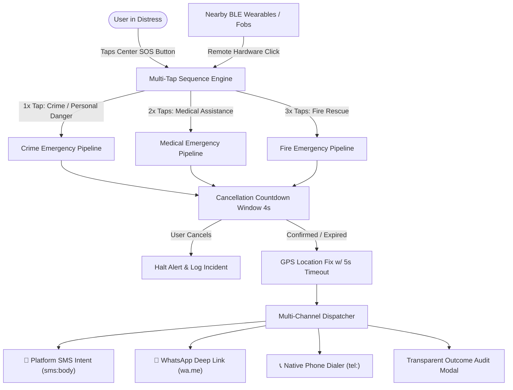

# SOS Guardian – Smart Emergency Alert System

[](https://github.com/)
[](LICENSE)

**SOS Guardian** is a modern, life-saving mobile emergency response application engineered for high-stress situations. It features a prominent, glowing circular SOS button at the center of the screen that accurately recognizes **single**, **double**, and **triple** taps to immediately identify the emergency type and trigger multi-channel dispatches (**SMS**, **WhatsApp**, and **Phone Call**) with precise GPS coordinates, while seamlessly discovering nearby **Bluetooth Low Energy (BLE)** wearable gadgets.

---

## 📋 System Architecture & Core Features



---

## 🚨 Emergency Classification Matrix

| Tap Sequence | Emergency Category | Theme Color | Prepared Alert Message | Action Channels |
| :--- | :--- | :--- | :--- | :--- |
| **1x Tap** | **Crime & Safety** | 🔴 Bold Red | `"CRIME & SAFETY EMERGENCY! I am in immediate personal danger and need urgent intervention. My current location is: [GPS Link]"` | SMS + WhatsApp + Phone Call |
| **2x Taps** | **Medical Aid** | 🔵 Urgent Blue | `"MEDICAL EMERGENCY! I need urgent medical assistance. My current location is: [GPS Link]"` | SMS + WhatsApp + Phone Call |
| **3x Taps** | **Fire Rescue** | 🟠 Rescue Orange | `"FIRE EMERGENCY! Fire assistance is needed urgently. My current location is: [GPS Link]"` | SMS + WhatsApp + Phone Call |

---

## 📂 Project Directory Structure

```text
sos-guardian/
├── public/                       # Full Interactive Mobile Web Application & PWA
│   ├── css/
│   │   └── styles.css            # Dark slate emergency theme, pulse rings, responsive mobile shell
│   ├── js/
│   │   ├── app.js                # Master UI controller and state machine
│   │   ├── tap_detector.js       # Multi-tap sequence recognition engine (850ms window)
│   │   ├── location_service.js   # GPS location fetch with 5-second strict timeout fallback
│   │   ├── alert_service.js      # SMS, WhatsApp, Phone dialer, & Web Audio emergency siren
│   │   ├── bluetooth_service.js  # Web Bluetooth API + Smartwatch/Panic Button peripheral manager
│   │   └── storage_service.js    # Secure persistence for contacts, preferences, and audit history
│   └── index.html                # High-contrast mobile interface with central circular SOS button
├── flutter_app/                  # Complete Native Flutter Mobile Codebase (Android & iOS)
│   ├── pubspec.yaml              # Dependencies: geolocator, flutter_blue_plus, url_launcher
│   ├── android/                  # AndroidManifest.xml with fine location, SMS, call & BLE permissions
│   ├── ios/                      # Info.plist with iOS usage descriptions and URL scheme queries
│   └── lib/
│       ├── main.dart             # App entry point
│       ├── models/               # Emergency type data structures
│       ├── services/             # Native tap engine, location, and alert dispatcher
│       └── screens/              # HomeScreen, SettingsScreen, and DevicesScreen
├── react_native_app/             # Complete React Native / Expo Codebase
│   ├── App.js                    # Mobile application root with multi-tap engine & modals
│   ├── package.json              # React Native, Expo Location, Haptics, Linking, BLE
│   ├── app.json                  # Native permissions configuration for Android & iOS
│   ├── components/SOSButton.js   # Pulsating circular red SOS button component
│   └── services/EmergencyEngine.js
├── serve.py                      # Local Python launcher for immediate testing
└── README.md                     # Comprehensive documentation
```

---

## ⚡ Quick Start: Run & Test Immediately

You can test the entire SOS Guardian mobile system immediately using the included local Python server:

```powershell
# From the project directory:
.\.venv\Scripts\python.exe sos-guardian\serve.py
```

1. The server starts at `http://localhost:8080` (and prints your local Wi-Fi IP so you can test directly on your physical smartphone).
2. **Central SOS Button:**
   - Single tap: Visual feedback marks `Tap 1/3: Crime Emergency`.
   - Double tap: Visual feedback marks `Tap 2/3: Medical Emergency`.
   - Triple tap: Visual feedback marks `Tap 3/3: Fire Emergency`.
3. **Cancellation Countdown:**
   - A 4-second audible siren countdown starts with a large **CANCEL / FALSE ALARM** button to prevent accidental alerts.
4. **Action Outcome Tracker:**
   - Transparently displays each stage of dispatch: GPS acquisition, SMS messenger intent, WhatsApp deep link, and Phone dialer.
5. **Nearby Devices:**
   - Tap the Bluetooth icon to scan real BLE devices (Web Bluetooth) or test remote emergency triggering using the built-in smart panic button simulator!
6. **Settings & Diagnostics:**
   - Configure your emergency contact with international `+` country code validation.
   - Run safe feature tests (Test SMS, Test WhatsApp, Test Dialer) without raising false alarms.
   - Toggle **Test Mode** on or off.

---

## 📱 Mobile App Implementations

### 1. Flutter (Android & iOS)

#### Prerequisites:
- Flutter SDK 3.0+
- Android Studio / Xcode

#### Running:
```bash
cd sos-guardian/flutter_app
flutter pub get
flutter run
```

#### Android Configuration (`AndroidManifest.xml`):
- `ACCESS_FINE_LOCATION` and `ACCESS_COARSE_LOCATION` for GPS coordinates.
- `SEND_SMS` and `CALL_PHONE` for emergency actions.
- `BLUETOOTH_SCAN` and `BLUETOOTH_CONNECT` for peripheral wearable triggers.
- `<queries>` block for WhatsApp (`com.whatsapp`), SMS (`smsto`), and Dialer (`tel`).

#### iOS Configuration (`Info.plist`):
- `NSLocationWhenInUseUsageDescription`
- `NSBluetoothAlwaysUsageDescription`
- `LSApplicationQueriesSchemes` (`whatsapp`, `tel`, `sms`)

---

### 2. React Native / Expo

#### Prerequisites:
- Node.js & npm / yarn
- Expo CLI

#### Running:
```bash
cd sos-guardian/react_native_app
npm install
npx expo start
```

---

## 🛡️ Reliability & Security Guarantees

1. **No Infinite GPS Blocking:**
   - If GPS coordinates cannot be locked within 5 seconds (e.g. inside tunnels or basements), the alert proceeds immediately with a fallback flag rather than delaying the alert.
2. **Transparent Platform Reporting:**
   - In accordance with Android and iOS security sandboxes, messaging and phone calls require OS-level intent launches. SOS Guardian **never simulates or falsely claims delivery** when an external messaging app has merely been opened.
3. **Accidental Press Mitigation:**
   - Configurable tap detection window (700–1000ms).
   - Configurable abort countdown (0–10 seconds) with audio siren and vibration feedback.
4. **Offline Resiliency:**
   - Direct cellular SMS (`sms:`) and Phone Dialing (`tel:`) function independently of internet connectivity. WhatsApp alerts warn gracefully if cellular data or Wi-Fi is unavailable.
5. **Privacy by Design:**
   - Contact details and incident history are stored securely in local device storage only.
