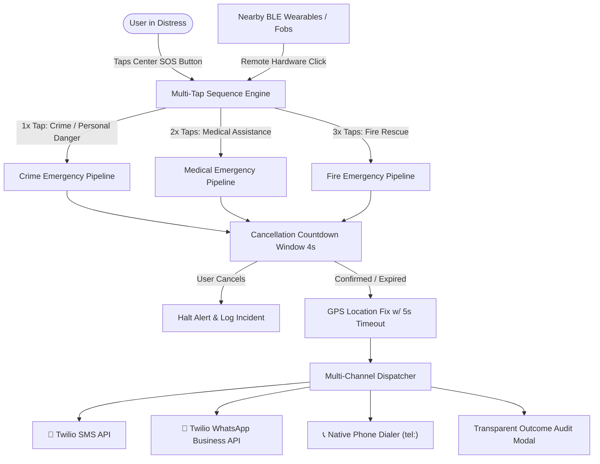

# SOS Guardian – Smart Emergency Alert System

[](https://github.com/)
[](LICENSE)

**SOS Guardian** is a modern, life-saving mobile emergency response application engineered for high-stress situations. It features a prominent, glowing circular SOS button at the center of the screen that accurately recognizes **single**, **double**, and **triple** taps to immediately identify the emergency type and trigger multi-channel dispatches (**SMS**, **WhatsApp**, and **Phone Call**) with precise GPS coordinates, while seamlessly discovering nearby **Bluetooth Low Energy (BLE)** wearable gadgets.

---

## 📋 System Architecture & Core Features



---

## 🚨 Emergency Classification Matrix

| Tap Sequence | Emergency Category | Theme Color | Prepared Alert Message | Action Channels |
| :--- | :--- | :--- | :--- | :--- |
| **1x Tap** | **Crime & Safety** | 🔴 Bold Red | `"CRIME & SAFETY EMERGENCY! I am in immediate personal danger and need urgent intervention. My current location is: [GPS Link]"` | SMS + WhatsApp + Phone Call |
| **2x Taps** | **Medical Aid** | 🔵 Urgent Blue | `"MEDICAL EMERGENCY! I need urgent medical assistance. My current location is: [GPS Link]"` | SMS + WhatsApp + Phone Call |
| **3x Taps** | **Fire Rescue** | 🟠 Rescue Orange | `"FIRE EMERGENCY! Fire assistance is needed urgently. My current location is: [GPS Link]"` | SMS + WhatsApp + Phone Call |

---

## 📂 Project Directory Structure

```text
sos-guardian/
├── public/                       # Full Interactive Mobile Web Application & PWA
│   ├── css/
│   │   └── styles.css            # Dark slate emergency theme, pulse rings, responsive mobile shell
│   ├── js/
│   │   ├── app.js                # Master UI controller and state machine
│   │   ├── tap_detector.js       # Multi-tap sequence recognition engine (850ms window)
│   │   ├── location_service.js   # GPS location fetch with 5-second strict timeout fallback
│   │   ├── alert_service.js      # SMS, WhatsApp, Phone dialer, & Web Audio emergency siren
│   │   ├── bluetooth_service.js  # Web Bluetooth API + Smartwatch/Panic Button peripheral manager
│   │   └── storage_service.js    # Secure persistence for contacts, preferences, and audit history
│   └── index.html                # High-contrast mobile interface with central circular SOS button
├── flutter_app/                  # Complete Native Flutter Mobile Codebase (Android & iOS)
│   ├── pubspec.yaml              # Dependencies: geolocator, flutter_blue_plus, url_launcher
│   ├── android/                  # AndroidManifest.xml with fine location, SMS, call & BLE permissions
│   ├── ios/                      # Info.plist with iOS usage descriptions and URL scheme queries
│   └── lib/
│       ├── main.dart             # App entry point
│       ├── models/               # Emergency type data structures
│       ├── services/             # Native tap engine, location, and alert dispatcher
│       └── screens/              # HomeScreen, SettingsScreen, and DevicesScreen
├── react_native_app/             # Complete React Native / Expo Codebase
│   ├── App.js                    # Mobile application root with multi-tap engine & modals
│   ├── package.json              # React Native, Expo Location, Haptics, Linking, BLE
│   ├── app.json                  # Native permissions configuration for Android & iOS
│   ├── components/SOSButton.js   # Pulsating circular red SOS button component
│   └── services/EmergencyEngine.js
├── serve.py                      # Local Python launcher for immediate testing
└── README.md                     # Comprehensive documentation
```

---

## ⚡ Quick Start: Run & Test Immediately

You can test the entire SOS Guardian mobile system immediately using the included local Python server:

```powershell
# From the project directory:
.\.venv\Scripts\python.exe sos-guardian\serve.py
```

1. The server starts at `http://localhost:8080` (and prints your local Wi-Fi IP so you can test directly on your physical smartphone).
2. **Central SOS Button:**
   - Single tap: Visual feedback marks `Tap 1/3: Crime Emergency`.
   - Double tap: Visual feedback marks `Tap 2/3: Medical Emergency`.
   - Triple tap: Visual feedback marks `Tap 3/3: Fire Emergency`.
3. **Cancellation Countdown:**
   - A 4-second audible siren countdown starts with a large **CANCEL / FALSE ALARM** button to prevent accidental alerts.
4. **Action Outcome Tracker:**
   - Transparently displays each stage of dispatch: GPS acquisition, Twilio SMS, automatic Twilio WhatsApp send, and Phone dialer.
5. **Nearby Devices & Networks:**
   - In the Android Flutter app, scan on demand for nearby BLE peripherals and Wi-Fi/hotspot networks. Android may require Bluetooth, Nearby Wi-Fi, and Location permissions, and may throttle Wi-Fi scans. The app does not collect device IP addresses.
   - Joining Wi-Fi/hotspots and pairing classic Bluetooth audio devices (such as most headphones and earbuds) are completed in Android Settings with the user's confirmation. BLE scanning only finds peripherals that advertise over BLE; it does not pair classic audio devices.
   - The browser PWA can request compatible BLE devices in supported browsers, but browser restrictions prevent it from scanning nearby Wi-Fi networks or controlling Wi-Fi/Bluetooth pairing.
6. **Settings & Diagnostics:**
   - Add and remove multiple emergency contacts using the country-code dropdown and a separate national-number field. The first contact is the primary recipient; use **Set as first** to change priority. Relationship and number details are stored in this browser on this device. SMS and WhatsApp alerts are sent automatically through the configured Twilio backend when an SOS is dispatched. If the automatic WhatsApp request fails or Twilio immediately rejects it, the alert report provides a manual WhatsApp option.
   - Optionally enable location tracking while the app is open. The browser requests permission, keeps updates in memory on this device, and shares the latest fix in SOS messages and the local incident log. Use HTTPS (or localhost); browsers may suspend background tabs, and closed browsers stop tracking. This is not a continuous background safety service.
   - Run safe feature tests (Test SMS, Test WhatsApp, Test Dialer) without raising false alarms.
   - Toggle **Test Mode** on or off.

### Sending SMS and WhatsApp through Twilio

Emergency SMS and WhatsApp messages are sent by the backend to the phone numbers saved in Settings. Configure Twilio before real sending:

1. In `backend`, copy `.env.example` to `.env` and set your Twilio Account SID, Auth Token, SMS-capable Twilio phone number, and WhatsApp sender (`TWILIO_WHATSAPP_NUMBER=whatsapp:+<number>`). Keep `.env` private and never commit it.
2. Install backend dependencies with `npm install`, then start it with `npm start`.
3. Keep the web app and backend running on the same computer. The backend listens on `127.0.0.1:3001` by default.
4. Enable WhatsApp for the Twilio sender and ensure each recipient has opted in to WhatsApp messages. WhatsApp may require approved templates for business-initiated messages. Turn **Test Mode** off only when you intend to send real alerts. Twilio and carrier charges may apply.

The outcome tracker reports when Twilio accepts a message; that does not guarantee delivery. If the backend or channel is unavailable or not configured, the tracker shows a failure instead of claiming the alert was sent. The **Test WhatsApp** diagnostic is simulated and never sends a real message.

---

## 📱 Native and Desktop Apps

The Flutter app is shared across Android phones/tablets, iPhone/iPad, macOS, and Windows. The browser PWA remains available on laptops and mobile devices as well.

#### Requirements
- Flutter SDK 3.0 or later
- Android builds: Android Studio / Android SDK
- iOS and macOS builds: macOS computer with Xcode; Apple signing is required for distribution
- Windows builds: Windows with Visual Studio 2022 and the **Desktop development with C++** workload

#### Add desktop targets to the existing Flutter project

The Android and iOS targets are already present. From `flutter_app`, generate the additional Windows and macOS platform projects, then fetch dependencies:

```bash
cd flutter_app
flutter create --platforms=windows,macos .
flutter pub get
```

Run on the connected or selected device:

```bash
flutter devices
flutter run -d <device-id>
```

Or build release artifacts:

```bash
flutter build apk                 # Android
flutter build ios                 # iPhone/iPad; macOS + Xcode required
flutter build macos               # macOS; macOS + Xcode required
flutter build windows             # Windows
```

For macOS, add `NSLocationUsageDescription` and `NSBluetoothAlwaysUsageDescription` to `macos/Runner/Info.plist` after generating the target. Apple App Store/TestFlight distribution additionally requires Apple Developer signing and App Store Connect setup. BLE gadget scanning is available on Android, iOS, and macOS; it is disabled on Windows where the selected Flutter BLE plugin has no Windows implementation.

The existing Android manifest and iOS `Info.plist` contain the mobile location, Bluetooth, SMS, and phone-intent declarations. The Android app also scans nearby Wi-Fi networks on demand and delegates joining Wi-Fi/hotspots and pairing classic audio devices to Android Settings. iOS does not provide equivalent general-purpose nearby Wi-Fi scanning to third-party apps. Native SMS and WhatsApp actions still use OS apps and may require confirmation; automatic Twilio SMS/WhatsApp sending is currently available in the web PWA when its separately configured backend is running.

---

### 2. React Native / Expo

#### Prerequisites:
- Node.js & npm / yarn
- Expo CLI

#### Running:
```bash
cd sos-guardian/react_native_app
npm install
npx expo start
```

---

## 🛡️ Reliability & Security Guarantees

1. **No Infinite GPS Blocking:**
   - If GPS coordinates cannot be locked within 5 seconds (e.g. inside tunnels or basements), the alert proceeds immediately with a fallback flag rather than delaying the alert.
2. **Transparent Platform Reporting:**
   - In accordance with Android and iOS security sandboxes, messaging and phone calls require OS-level intent launches. SOS Guardian **never simulates or falsely claims delivery** when an external messaging app has merely been opened.
3. **Accidental Press Mitigation:**
   - Configurable tap detection window (700–1000ms).
   - Configurable abort countdown (0–10 seconds) with audio siren and vibration feedback.
4. **Offline Resiliency:**
   - Direct cellular SMS (`sms:`) and Phone Dialing (`tel:`) function independently of internet connectivity. WhatsApp alerts warn gracefully if cellular data or Wi-Fi is unavailable.
5. **Privacy by Design:**
   - Contact details and incident history are stored securely in local device storage only.
